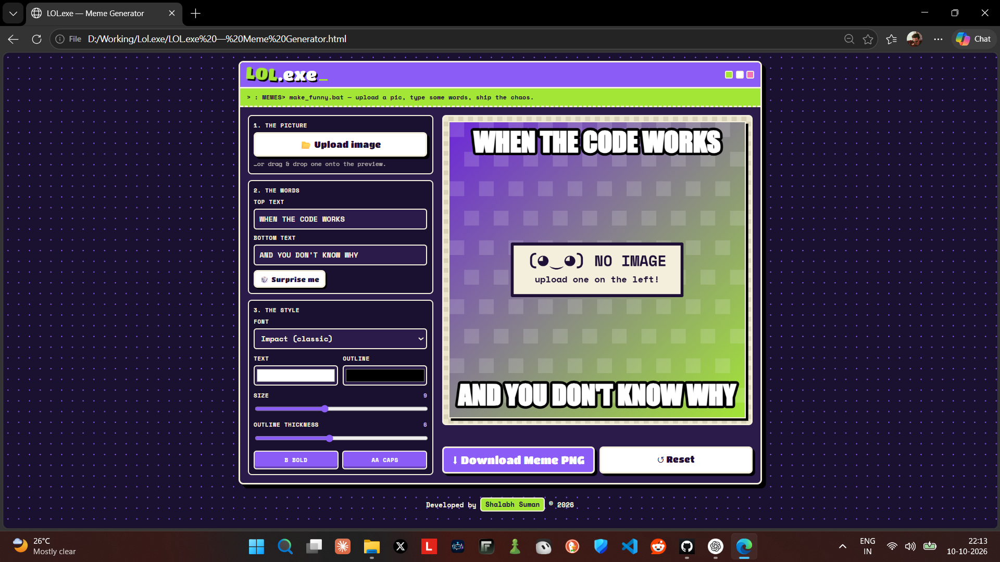

# 😂 LOL.exe — Meme Generator

A fun, chunky, and easy-to-use meme generator built with HTML, CSS, and JavaScript. Upload your favorite image, add funny text, customize the style, and download your meme as a PNG!

## ✨ Features

- 🖼️ Upload images or drag and drop them into the preview.
- ✍️ Add custom top and bottom text.
- 🔤 Choose from multiple bold, meme-style fonts.
- 🎨 Customize text and outline colors.
- 📏 Adjust text size and outline thickness.
- 💪 Toggle bold text and uppercase letters.
- 🎲 Generate random meme captions.
- ⬇️ Download memes as PNG images.
- 🔄 Reset the editor anytime.
- 📱 Responsive design for mobile and desktop.
- 🌙 Light and dark theme support.
- ⚡ Smooth animations and a playful retro UI.

## 🛠️ Built With

- HTML5
- CSS3
- Vanilla JavaScript
- HTML Canvas API
- Google Fonts

## 📸 Screenshot



> **Add your screenshot:** Take a screenshot of the running website and save it as `screenshot.png` in the project folder.

## 🚀 How to Run

1. Download or clone this repository.
2. Open the project folder.
3. Open `LOL.exe — Meme Generator.html` in your browser.
4. Upload an image and start creating memes!

No installation or build tools required.

## 📂 Project Structure

```text
LOL.exe-Meme-Generator/
├── LOL.exe — Meme Generator.html
├── screenshot.png
└── README.md
```

## 🎯 Purpose

This project was created to practice frontend development, DOM manipulation, canvas-based image editing, responsive UI design, and JavaScript event handling.

## 👨‍💻 Developer

**Shalabh Suman**

B.Tech CSE Student | Aspiring Software Developer

---

Made with 💜, code, and a little chaos.

